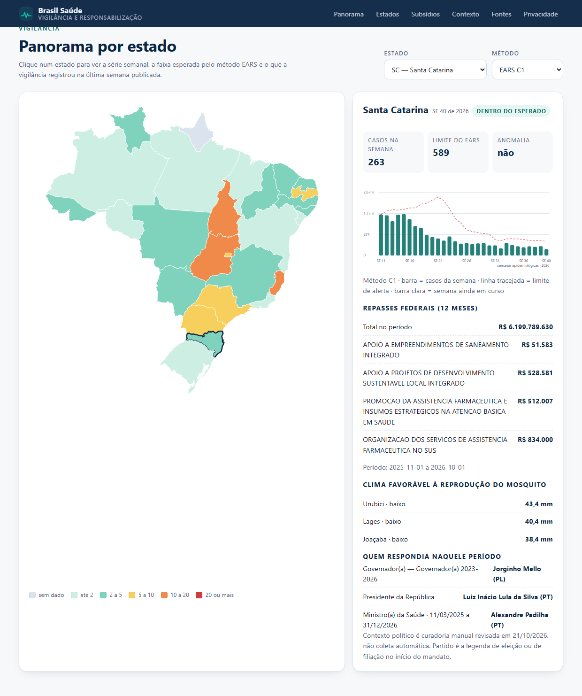
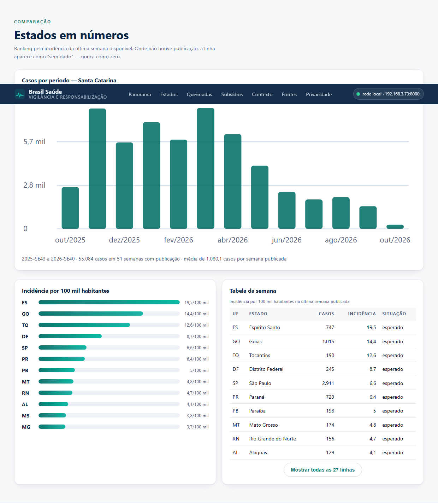
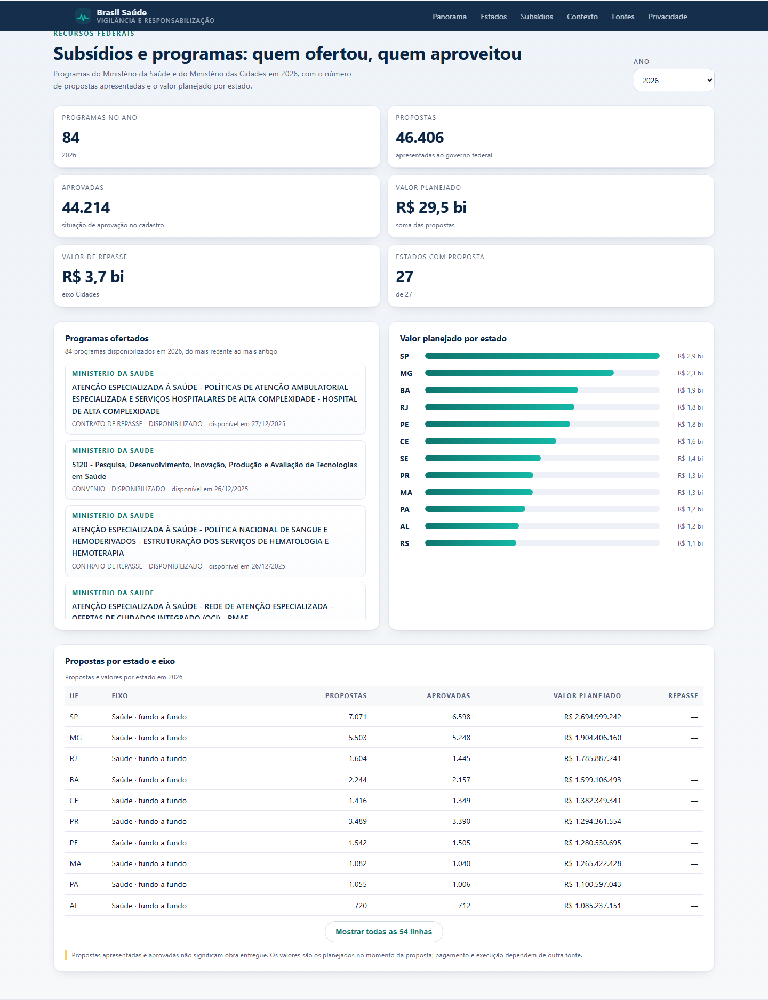
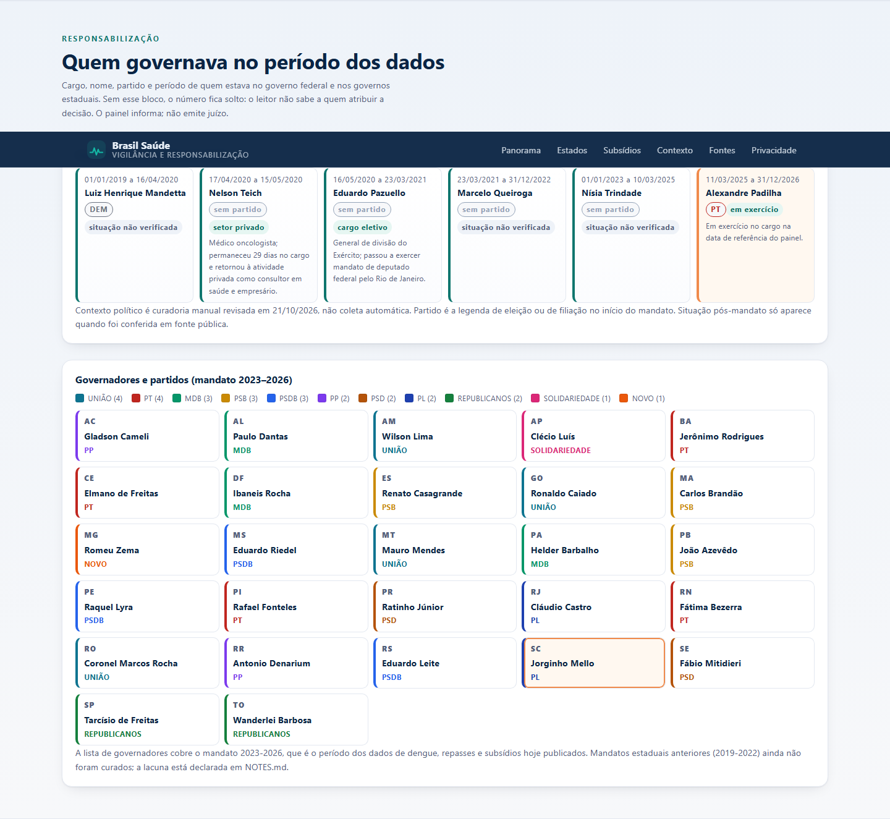
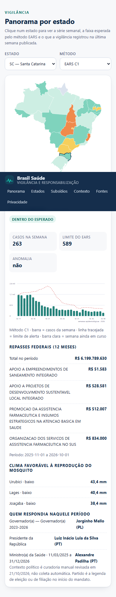

# Brasil Saúde


-brightgreen)


Um painel público que responde, com fonte em cada número: **qual a situação da dengue no
meu estado, isso é anômalo, quanto o governo federal repassou, quais programas foram
ofertados e quem governava quando tudo isso aconteceu?**

Não é um repositório de scripts. É uma interface que abre no navegador, mostra o mapa do
Brasil, a série semanal com o limite do EARS, os repasses da função Saúde, a oferta de
programas federais, o aproveitamento por estado e o contexto político do período. Todo
dado exibido carrega órgão, URL, período de referência e data de coleta.

## Classificação

| Dimensão | Valor |
|----------|-------|
| **Propósito** | `utilidade` · `estudo` · `portfólio` |
| **Maturidade** | `funcional (local e rede doméstica)` |
| **O que estou treinando** | dados públicos de saúde, EARS, FastAPI, SQLite, DBA, autorização, frontend sem framework |
| **Quem usaria** | conselhos de saúde, jornalistas de dados, gestores municipais e estaduais, pesquisadores |

> A maturidade é `funcional (local)` porque o painel roda com dado real, mas não está
> publicado na internet: sem HTTPS, sem deploy e sem autenticação de produção.

## Capturas



*Panorama: mapa por incidência na última semana consolidada (2026-SE40), série de 30
semanas em barras com a linha do limite EARS, repasses dos 12 meses e quem ocupava os
cargos no período.*



*Comparação entre estados: barra por incidência e tabela com casos, taxa e situação.
No celular a tabela vira lista de cartões, sem rolagem lateral.*



*Subsídios: 75 programas ofertados em 2026 pelos Ministérios da Saúde e das Cidades,
valor planejado por estado e tabela de propostas por eixo.*



*Contexto político: quem ocupou o Ministério da Saúde desde 2019 e o partido de cada
governador do mandato 2023–2026. Cargo, nome, partido, período e fonte — sem juízo.*



*No celular (390 × 844 px): mapa, cartões e gráfico empilhados, tabelas convertidas em
cartões e menu com rolagem própria. Verificado por script: `scrollWidth` igual a
`clientWidth` em 390, 768 e 1440 px.*

## Como rodar

```powershell
.\.venv\Scripts\Activate.ps1
python scripts/coletar.py tudo          # coleta e grava no SQLite local
python -m uvicorn src.app:app --port 8000
```

Abra <http://127.0.0.1:8000>. Documentação interativa da API em `/api/docs`.

### Ver pelo celular (mesma rede Wi-Fi)

```powershell
powershell -ExecutionPolicy Bypass -File scripts\servir_auto.ps1
```

O script sobe o painel escondido, imprime o endereço e mantém um **vigia** que reinicia o
servidor se ele cair — por exemplo `http://192.168.0.10:8000`. Nada é exposto na internet:
não há redirecionamento de porta nem túnel.

**Se o celular não abrir**, o Windows quase sempre é o culpado: o firewall bloqueia conexão
de entrada e a rede de casa costuma estar classificada como *Pública*. Dois comandos
resolvem, e ambos pedem administrador:

```powershell
powershell -ExecutionPolicy Bypass -File scripts\diagnosticar_rede.ps1
powershell -ExecutionPolicy Bypass -File scripts\liberar_firewall.ps1 -RedePrivada
```

O primeiro diz exatamente qual dos cinco pontos está falhando (escuta, IP, perfil de rede,
regra de firewall, resposta pelo IP). O segundo libera a porta em todos os perfis e, com
`-RedePrivada`, reclassifica a rede atual. Se ainda assim não abrir, desligue o
*isolamento de clientes* (AP isolation) no roteador.

### Comandos do dia a dia

```powershell
python -m pytest -q                 # suíte completa
python -m ruff check .              # lint
python scripts/backup_sqlite.py backup
python scripts/backup_sqlite.py restaurar data/backups/<arquivo>.db
```

## O que deu certo

- **Coleta real, sem dado inventado.** 27 UFs, 5.571 municípios, 51 semanas de dengue por
  estado, R$ 187,8 bilhões de repasses federais em 12 meses, 268 estações de clima,
  75 programas federais em 2026 e 84 em 2025, 6 ministros da Saúde e 27 governadores.
- **Proveniência obrigatória.** Toda tabela aponta para uma linha de `fonte` com órgão,
  URL, período e data de coleta. A tela de fontes mostra 7 de 8 fontes com status `ok`.
- **EARS com teste canônico.** C1 (7 semanas, k=3) e C2 (janela deslocada) calculados do
  zero, com exemplo documentado em `tests/test_ears.py`.
- **Lacuna não é zero.** Semana não publicada entra como `None`, aparece como buraco no
  gráfico e como "sem dado" na tabela.
- **Frontend sem framework e sem CDN.** Zero requisição a terceiros: nenhum CDN, nenhuma
  fonte externa, nenhum script de análise. Mapa, gráfico de barras e ranking são SVG e
  HTML gerados no navegador.
- **Responsivo de verdade.** Layout verificado em 390, 768 e 1440 px sem rolagem
  horizontal (`scrollWidth == clientWidth`).
- **Política de dados publicada** em `/privacidade` e em `docs/politica_dados.md`.
- **Autorização da Fase 2.** RBAC/ABAC local com papéis `admin`, `gestor_estadual` e
  `publico`; `gestor_estadual` recebe 403 ao pedir outro estado. Sem login no MVP.
- **Backup e restauração com prova.** Cópia pela API do SQLite, `integrity_check`,
  SHA-256 e restauração conferida byte a byte.
- **82 testes verdes e `ruff` limpo**, com CI no GitHub Actions.

## O que não foi alcançado

| Item | Por que ficou de fora |
| --- | --- |
| Outras doenças (chikungunya, zika) | a API do InfoDengue responde (validado), mas exige coluna `doenca` no esquema e recálculo do EARS por doença — virou ciclo do roadmap, não do MVP |
| Internações, SRAG e óbitos | dependem de bases anuais grandes do OpenDataSUS (SIH/SUS), sem recorte por UF pronto |
| Queimadas e fumaça | o INPE passou a exigir cadastro/token para o CSV por estado |
| Desastres (enchentes do RS) | o S2iD/MIDR não tem API aberta documentada; o dado existe em planilha e relatório |
| Obras por esfera (federal/estadual/municipal) | temos proposta e valor planejado; execução física e esfera exigem o Obrasgov |
| Saneamento (SNIS) | diagnóstico anual em planilha; fora do escopo do ciclo |
| Prefeitos por município | 5.570 registros; exige curadoria e cuidado extra com privacidade |
| Correlação chuva → dengue | a série de clima publicada cobre 14 dias por estação; correlação honesta precisa de anos de série diária |
| Autenticação de produção | o MVP é leitura pública; login com MFA é Fase 3 (`docs/arquitetura/`) |
| Deploy público | proibido no contrato do MVP |

## Por que demorou mais que o previsto

1. **Fontes que não entregam o que prometem.** O PySUS não instala no Python 3.14 (sem
   wheel para `pyreaddbc`); a API de dados abertos do Ministério da Saúde responde com
   paginação instável; o INMET responde 204 no endpoint de série por estação; o
   `mailtura.com` sugerido como serviço de e-mail é um site de apostas, não um relay.
2. **Formato de governo é formato de governo.** CSV em Latin-1, JSON que devolve acento
   sem declarar charset (o Transferegov faz isso), coluna de função do Portal da
   Transparência com 36 posições e separador `;`.
3. **Semana epidemiológica brasileira não é semana ISO.** SE1 é a semana que contém
   4 de janeiro, domingo a sábado. Usar ISO erra o ano em toda virada.
4. **Refazer o frontend depois de ver o resultado.** A primeira versão tinha grid sem
   `minmax(0, 1fr)` e um `<select>` dimensionado pela opção mais longa — o resultado era
   rolagem horizontal e sensação de "mobile e desktop ao mesmo tempo".
5. **Defeitos silenciosos que só apareceram na verificação visual.** O mapa pintava
   todos os estados de cinza porque a UF era gravada antes de os dados chegarem; e a
   projeção de Mercator devolvia radianos enquanto a longitude estava em graus, o que
   achatava o Brasil em 2 px de altura. Nenhum dos dois quebrava teste.

## O que fazer agora

1. Chikungunya e zika (fonte já validada; falta esquema e seletor).
2. Série diária longa de clima por estado — destrava a correlação com a dengue.
3. Obrasgov e SNIS: quanto foi destinado, quanto foi executado.
4. Internações (SIH/SUS) para falar de gravidade, não só de notificação.
5. Fase 3 de identidade: gov.br (OAuth2/OIDC) e MFA para acesso administrativo.

O detalhamento de cada item, com a fonte candidata e o obstáculo, está em
[`docs/roadmap_dados.md`](docs/roadmap_dados.md).

## Como o painel é montado

```text
scripts/coletar.py  →  src/fontes/*  →  SQLite (data/brasil_saude.db)  →  src/servicos/*  →  FastAPI  →  frontend/
```

| Camada | Arquivo | Papel |
| --- | --- | --- |
| Coleta | `src/fontes/{ibge,infodengue,inmet,transparencia,transferegov,responsaveis}.py` | baixa, normaliza e grava com carimbo de data |
| Rede | `src/rede.py` | retry com espera crescente, decodificação UTF-8 com queda para Latin-1 |
| Detecção | `src/ears.py` | C1 e C2, janela móvel, desvio amostral |
| Serviços | `src/servicos/*` | regra de negócio: série, incidência, repasses, subsídios, contexto |
| API | `src/rotas/*` | contrato JSON tipado, 422 para UF inválida, 503 para fonte fora do ar |
| Tela | `frontend/` | HTML, CSS e JS puros; SVG gerado no cliente |

### Endpoints principais

| Rota | O que devolve |
| --- | --- |
| `GET /api/resumo` | números do topo: casos da semana, anomalias em 12 semanas, repasses, fontes |
| `GET /api/estados?metodo=C1` | situação da última semana por UF (alimenta o mapa) |
| `GET /api/estados/{uf}` | série com esperado e limite do EARS |
| `GET /api/estados/{uf}/repasses` | repasses federais da função Saúde |
| `GET /api/estados/{uf}/clima` | chuva e temperatura por município |
| `GET /api/estados/{uf}/contexto` | governador, presidente e ministros do período |
| `GET /api/subsidios?ano=2026` | programas ofertados e propostas por UF |
| `GET /api/contexto` | linha do tempo de ministros e governadores |
| `GET /api/fontes` | proveniência de tudo que aparece na tela |

## Segurança e privacidade

- Nenhum segredo em arquivo versionado; a chave vive em variável de ambiente.
- API somente leitura, CORS restrito à própria origem, corpo limitado a 1 MB.
- Nenhum cookie, nenhum rastreador, nenhuma requisição a terceiros no navegador.
- Dado de saúde sempre agregado por semana e por estado: não há registro individual.
- Política completa em [`docs/politica_dados.md`](docs/politica_dados.md) e em `/privacidade`.

## Loop Engineering

Cada ciclo é uma hipótese pequena, medida e aceita ou revertida. O registro está em
[`log_loop.md`](log_loop.md), as decisões em [`NOTES.md`](NOTES.md) e o passo a passo em
[`DIARIO.md`](DIARIO.md).

## Contribuições

Achou um número errado? Abra uma issue com o valor, a semana e a fonte oficial que
contradiz o painel. Correção de dado de saúde é sempre resolvida a favor do boletim
oficial.

## Licença

MIT. Os dados pertencem às instituições que os publicam; o código é livre.
