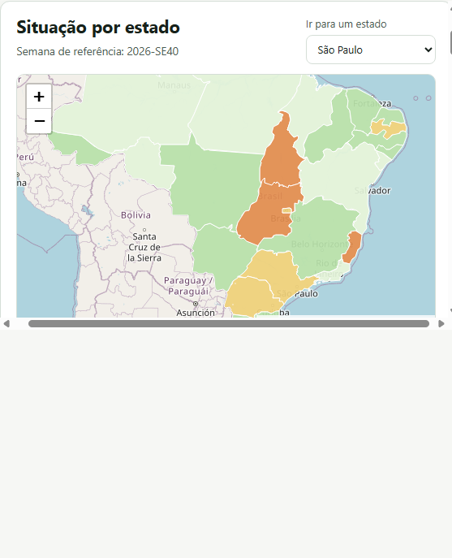
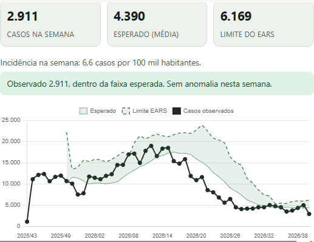
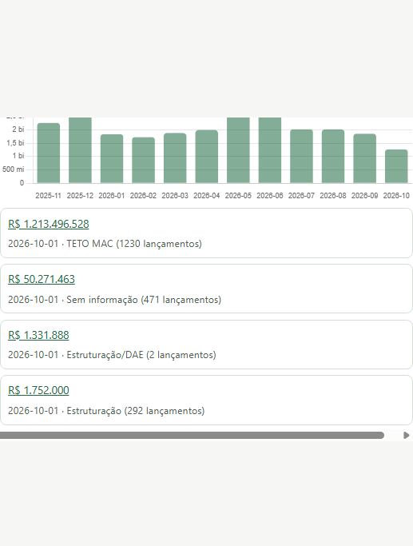
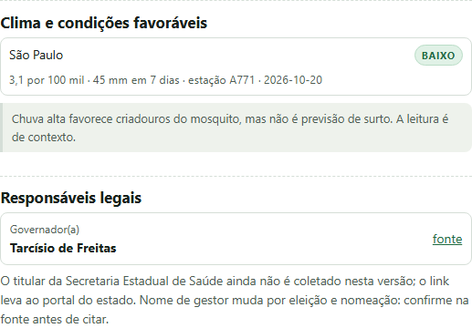
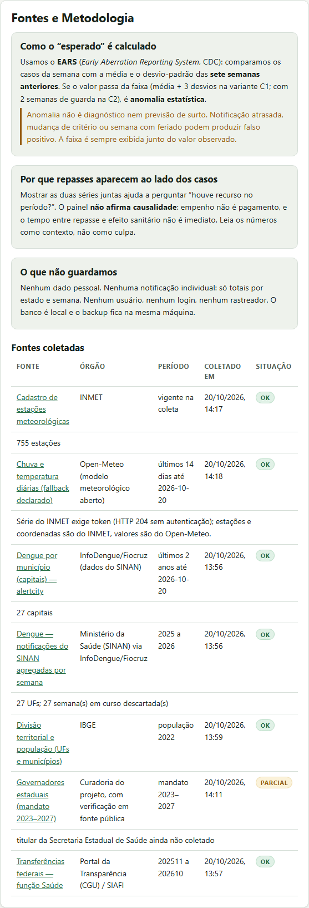

# Brasil Saúde


-brightgreen)

Um painel público que responde, com fonte em cada número: **qual a situação da
dengue no meu estado, isso é anômalo, houve repasse federal e quem responde por
isso?**

Não é um repositório de scripts. É uma interface que abre no navegador, mostra
o mapa do Brasil, a série semanal com a faixa esperada pelo EARS, os repasses
da função Saúde e as condições climáticas dos municípios com maior incidência.
Todo dado exibido carrega órgão, URL, período e data de coleta.

## Classificação

| Dimensão | Valor |
|----------|-------|
| **Propósito** | `utilidade` · `estudo` · `portfólio` |
| **Maturidade** | `funcional (local)` |
| **O que estou treinando** | dados públicos de saúde, modelagem, EARS, FastAPI, SQLite, DBA, autorização |
| **Quem usaria** | conselhos de saúde, jornalistas de dados, gestores municipais/estaduais, pesquisadores |

> A maturidade é `funcional (local)` porque o painel roda e mostra dado real,
> mas não está publicado: sem HTTPS, sem deploy e sem autenticação de produção.

## Capturas



*Mapa por incidência na última semana consolidada (2026-SE40), com cinza para
estado sem dado e borda tracejada para anomalia estatística.*



*Ao escolher o estado: casos da semana, faixa esperada, gráfico com observado,
esperado e limite — e a explicação de que anomalia não é diagnóstico.*



*Repasses da função Saúde: soma mensal, últimos lançamentos com link para a
fonte e aviso de que o painel não afirma causalidade.*



*Clima nos municípios com maior incidência (chuva de 7 dias) e o responsável
legal pelo SUS estadual, com link para a fonte.*



*“Fontes e Metodologia” lê o banco: órgão, período, data de coleta e situação
de cada fonte — sem texto fixo no HTML.*

## Como rodar

Requisitos: Python 3.11+ e Git. O projeto foi testado no Python 3.14/Windows.

```powershell
cd D:\Projetos\brasil_saude
python -m venv .venv
.\.venv\Scripts\Activate.ps1
pip install -r requirements.txt

# 1. coleta (IBGE, dengue, capitais, repasses, clima, responsáveis, EARS)
python scripts/coletar.py tudo

# 2. abra o painel
python -m uvicorn src.app:app --host 127.0.0.1 --port 8000
# http://127.0.0.1:8000  ·  API em /api/docs
```

Verificação:

```powershell
python -m pytest -q          # 63 testes
python -m ruff check .       # lint
python scripts/backup_sqlite.py criar
python -m pytest tests/test_backup.py -q
```

## Arquitetura

```
frontend/ (HTML/CSS/JS, sem build)
        │  /api/estados, /repasses, /clima, /responsaveis, /fontes
        ▼
src/app.py (FastAPI)
   ├── src/servicos/epidemiologia.py  → série, lacunas, EARS
   ├── src/servicos/orcamento.py      → repasses por UF
   ├── src/servicos/clima.py          → incidência + chuva
   └── src/servicos/…                 → (MDSOA: um serviço por domínio)
        ▼
data/brasil_saude.db (SQLite + WAL) ← backup verificado
```

- **Coleta:** `src/fontes/` (IBGE, InfoDengue, Portal da Transparência, INMET/Open-Meteo).
- **Proveniência:** tabela `fonte`; caso sem fonte é recusado por chave estrangeira.
- **Metodologia:** EARS C1/C2 em `src/ears.py`, com exemplo canônico nos testes.
- **Fase 2 (identidade):** RBAC/ABAC local em `src/auth/` e
  [`docs/arquitetura/`](docs/arquitetura/README.md).

## Fontes e metodologia

| Dimensão | Fonte | O que entra | Período |
|---|---|---|---|
| Território/população | IBGE (localidades e Censo 2022) | 27 UFs, 5.571 municípios | vigente |
| Dengue | SINAN agregado pelo InfoDengue (Fiocruz) | notificações por UF/semana | últimas 51 semanas |
| Dengue municipal | InfoDengue `alertcity` | capitais (incidência) | 2 anos |
| Repasses | Portal da Transparência/SIAFI | função 10 (Saúde), por UF/mês | 12 meses |
| Estações | INMET | cadastro (nome, UF, coordenadas, IBGE) | vigente |
| Chuva/temperatura | Open-Meteo (**fallback declarado**) | série diária nas coordenadas da estação | 14 dias |
| Responsáveis | curadoria com verificação pública | governadores 2023–2027 | mandato |

O EARS compara a semana com a média e o desvio-padrão das **sete semanas
anteriores** (média + 3 desvios na C1; C2 ignora as duas semanas mais recentes).
A tela sempre mostra a faixa esperada junto do observado e diz **“anomalia
estatística”**, nunca “surto”.

## Segurança e Privacidade

**DICA aplicado (COSEGI):**

- **Disponibilidade:** cache local, retry com backoff, fallback de fonte,
  falha parcial tolerada, backup com restauração testada.
- **Integridade:** FK obrigatória para `fonte`, `CHECK` de faixa, transação por
  lote, lacuna marcada como `None` (não zero).
- **Confidencialidade:** nenhum dado pessoal. A menor célula é município ×
  semana; não há nome, CPF, CNS, endereço ou e-mail no banco. O protótipo de
  e-mail guarda UF e papel, **não** destinatário.
- **Autenticidade:** cada número tem URL da fonte e data de coleta visíveis.

**Superfície:** API somente leitura no painel público; CORS restrito a origens
locais; corpo limitado a 1 MB; UF validada no servidor; frontend usa
`textContent` (sem `innerHTML` com dado da rede).

**O que falta para produção:** HTTPS, rate limit, auditoria de acesso, MFA,
revisão de dependências e teste de intrusão. Está declarado em
[`docs/dba/seguranca_dados.md`](docs/dba/seguranca_dados.md).

## Fase 2 — identidade, acesso e serviços

Protótipo funcional de autorização com três papéis (`publico`,
`gestor_estadual`, `admin`). O critério de sucesso é testado: **gestor de SP
recebe 403 ao pedir dados de RJ**.

- [`docs/arquitetura/matriz_permissoes.md`](docs/arquitetura/matriz_permissoes.md)
- [`docs/arquitetura/integracao_servicos.md`](docs/arquitetura/integracao_servicos.md)
  (e-mail multi-tenant, gov.br OIDC, MFA, DATASUS)

```powershell
$env:BRASIL_SAUDE_AUTH_DEMO = "1"
# POST /api/auth/demo-token {"papel":"gestor_estadual","uf":"SP"}
# GET  /api/gestao/estados/SP/resumo   -> 200
# GET  /api/gestao/estados/RJ/resumo   -> 403
```

## Limitações declaradas

- **Sem deploy público** e sem HTTPS: roda localmente.
- **Dengue apenas.** Zika e chikungunya estão no backlog.
- **Sem microdado restrito.** A série vem agregada; não há acesso ao SINAN
  nominal (que exigiria Termo, certificado e CNES).
- **Clima:** a série do INMET exige token (HTTP 204 sem autenticação); os
  valores vêm do Open-Meteo, e a tela diz isso.
- **Secretários estaduais de saúde** ainda não são coletados (CONASS carrega a
  lista via JavaScript sem endpoint estável). O painel mostra o governador e
  avisa a lacuna.
- **Sem dado pessoal:** por decisão de projeto, não por falta de vontade.

## Loop Engineering

Cada etapa foi um ciclo: hipótese → mudança → teste → métrica real →
**ACEITO/REJEITADO** em [`log_loop.md`](log_loop.md). O diário didático está em
[`DIARIO.md`](DIARIO.md); as decisões, em [`NOTES.md`](NOTES.md); a modelagem,
em [`docs/modelagem.md`](docs/modelagem.md).

## 🚀 Convite à interação

**Iniciantes:** há tarefas pequenas e bem delimitadas no
[`docs/backlog.md`](docs/backlog.md) — melhorar uma mensagem de erro, escrever
um teste, corrigir uma explicação. Eu reviso e ajudo.

**Colegas de dados e programação:** encontrou número sem fonte, gargalo ou
brecha? Abra uma Issue ou PR. Discussão técnica é bem-vinda, inclusive quando
discorda de uma decisão registrada.

**Recrutadores:** o que está aqui é verificável — suíte de testes, backup
restaurado, documentação de DBA e um protótipo de autorização que bloqueia
acesso cruzado entre estados.

## Apoio

- **PIX:** `a8b68e14-edfe-4450-88f2-c2af4aca2a6c`
- **Buy Me a Coffee:** <https://buymeacoffee.com/georgehbecker>
- **LinkedIn:** <https://www.linkedin.com/in/georgehbecker/>

## Topics sugeridos

```text
python fastapi sqlite dados-publicos saude-sus dengue ears datasus lgpd loop-engineering transparencia
```
