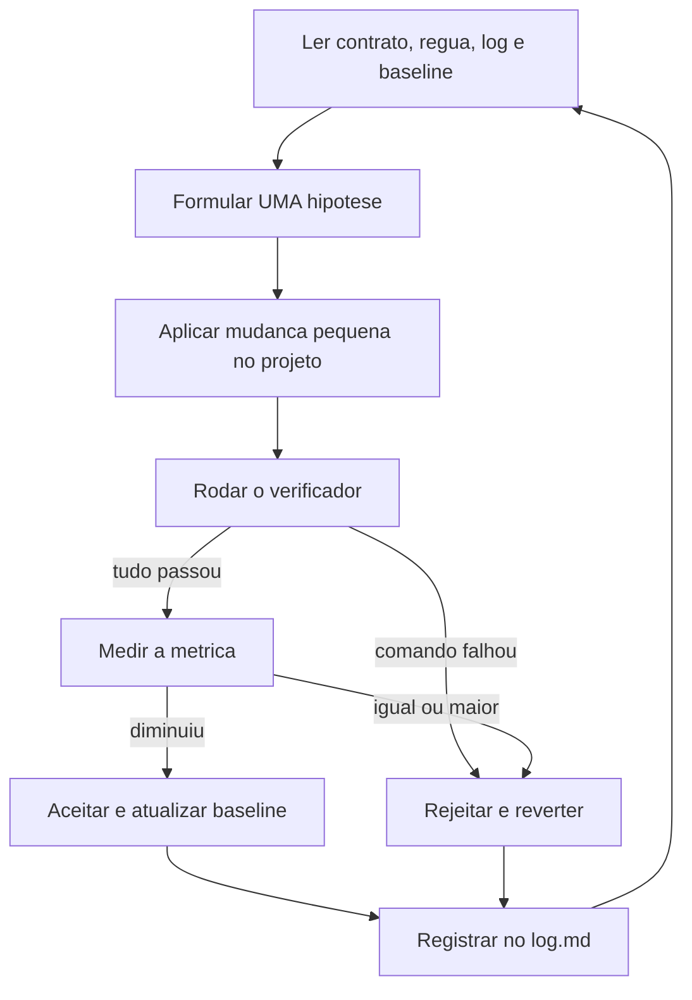

# Loop Engineering — agente de melhoria contínua do Brasil Saúde

Este diretório guarda o "cérebro" de um agente que melhora o painel em ciclos: ele lê o
contrato, propõe UMA mudança pequena, testa, mede o resultado e decide manter ou
reverter — registrando tudo no log.

## Mapa dos arquivos

| Arquivo / pasta | Quem escreve | Para que serve |
|---|---|---|
| `program.md` | você (humano) | Contrato: objetivo, regras, critérios de aceite/rejeição e limites. |
| `config_loop.json` | você (humano) | O mesmo contrato em formato de máquina: comandos, métrica e limites. |
| `referencias_indicadores.json` | você (humano) | A régua: quais indicadores o painel deve publicar. |
| `system_prompt.md` | você / IA | Como o agente deve se comportar (identidade, passos, segurança). |
| `log.md` | o agente | Histórico de cada iteração: hipótese, resultado e decisão. |
| `baseline.json` | o verificador | Os números do jogo: valor inicial, melhor valor, meta e progresso. |
| `medir_qualidade.py` | ferramenta | Calcula a dívida de rastreabilidade (0 a 1). |
| `outputs/` | o verificador | Relatórios e saídas de cada iteração. |
| `verificar_iteracao.py` | ferramenta | Roda os testes, mede a métrica, compara e sugere a decisão. |

O projeto alvo é a **raiz do repositório** (`verificacao.diretorio_de_trabalho` = `..`);
não existe pasta `workspace/` neste projeto.

## A métrica em uma frase

Todo indicador publicado precisa de quatro documentos — **publicado**, **fonte** (órgão +
URL https), **período** e **validado** (número + data). A dívida é a fração de documentos
que faltam:

```
dívida = itens faltando / total de itens
0.0000 = catálogo 100% rastreável   |   1.0000 = nada publicado ainda
```

O formato esperado da publicação está no docstring de `medir_qualidade.py`.

## Fluxo de uma iteração



## Regra de ouro dos arquivos

- `program.md`, `config_loop.json` e `referencias_indicadores.json` dizem **o que** pode
  ser feito (só o humano altera).
- O agente **não edita** este diretório.
- Sem emojis nos arquivos e nas saídas deste diretório (compatibilidade com o console do
  Windows).

## Como usar — modo 1: com o agente do chat (recomendado para começar)

1. Ative o ambiente: `.\.venv\Scripts\Activate.ps1`.
2. Grave a linha de base:
   `python meu-loop-agente/verificar_iteracao.py medir --definir-baseline`
3. No chat, peça: "Leia `meu-loop-agente/system_prompt.md` e `meu-loop-agente/program.md`
   e execute uma iteração."
4. Para registrar a decisão:
   `python meu-loop-agente/verificar_iteracao.py registrar --decisao ACEITO --hipotese "texto"`

## Como usar — modo 2: verificação manual

```powershell
python meu-loop-agente/verificar_iteracao.py estado                 # situação atual
python meu-loop-agente/medir_qualidade.py --detalhe                 # o que falta, item a item
python meu-loop-agente/verificar_iteracao.py medir                  # mede a métrica agora
python meu-loop-agente/verificar_iteracao.py verificar --hipotese "troquei X por Y"
python meu-loop-agente/verificar_iteracao.py registrar --decisao REJEITADO --hipotese "troquei X por Y"
```

O comando `verificar`:

- roda todos os comandos de verificação (testes e lint);
- mede a métrica principal;
- compara com o melhor valor de `baseline.json`;
- sugere a decisão (**ACEITO** se tudo passou e a métrica diminuiu; **REJEITADO** caso contrário);
- grava um relatório completo em `outputs/iteracao_000001/relatorio.json`.

Códigos de saída do `verificar`: `0` = candidato a ACEITO · `2` = candidato a REJEITADO ·
`1` = erro de configuração.

## Segurança (regras que o agente segue)

- **Uma hipótese por iteração**, com diff pequeno (menos de 50 linhas).
- **Commit antes de cada iteração**: se a mudança for rejeitada, reverter é um comando só
  (`git checkout -- .`).
- **Nunca** tocar em arquivos proibidos (ver `program.md`), `.env`, segredos ou credenciais.
- **Parar** depois de 3 falhas seguidas de verificação e reportar.
- Limites de parada: meta atingida, 20 iterações ou 5 rejeições seguidas.

## Próximo passo (ainda não implementado)

Modo autônomo: um script que chama a API do DeepSeek (modelo e temperatura ficam em
`config_loop.json` -> `agente`) e roda o ciclo sem o chat. Vai precisar da chave
`DEEPSEEK_API_KEY` na variável de ambiente do usuário (o campo comentado existe em
`.env.example`).
